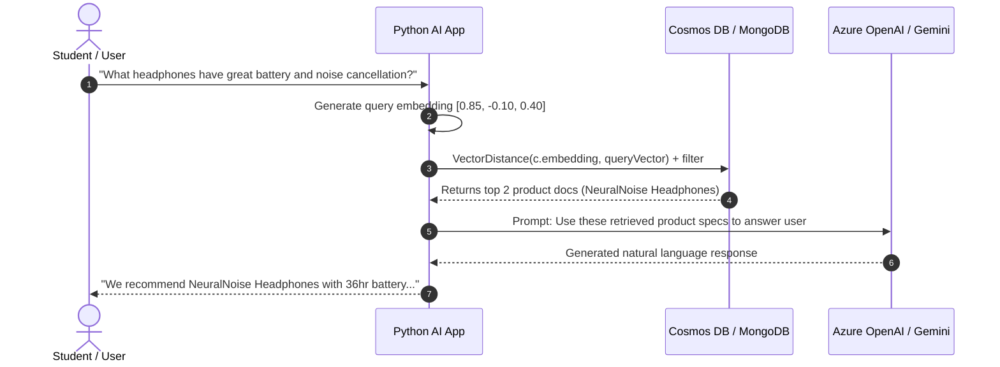

# Day 4: Vector Search & AI in Modern NoSQL Databases

For Data Science and AI (DSAI) professionals, the database is no longer just a place to store tabular records or raw JSON. In modern Generative AI, Retrieval-Augmented Generation (RAG), and recommendation systems, **vector search** turns NoSQL databases into the memory layer for AI agents and Large Language Models (LLMs).

---

## 1. What Are Vector Embeddings?

An **embedding** is an array of floating-point numbers (a high-dimensional vector) representing the semantic meaning of text, audio, images, or tabular data.

```text
"NeuralNoise Cancelling Headphones" ────[Embedding Model]────> [0.82, -0.15, 0.44, ... (1536 dims)]
"Wireless Bluetooth Earbuds"        ────[Embedding Model]────> [0.80, -0.12, 0.41, ... (1536 dims)]
"Winter Wool Coat"                  ────[Embedding Model]────> [-0.55, 0.62, -0.10, ... (1536 dims)]
```

* Semantically related items are positioned close to each other in vector space.
* Unrelated items are positioned far apart.

---

## 2. Why Store Vectors in NoSQL? (The Hybrid Search Advantage)

In the past, architectures separated systems: metadata lived in SQL/NoSQL, while vectors lived in specialized vector engines (Pinecone, Milvus, Chroma). This led to synchronization lag, complex pipelines, and high cloud costs.

Modern Azure Cosmos DB and MongoDB provide **native vector storage and indexing directly within documents**:

```json
{
  "id": "PROD-101",
  "name": "NeuralNoise Cancelling Headphones",
  "category": "Audio",
  "price": 299.99,
  "inventory": 45,
  "embedding": [0.82, -0.15, 0.44]
}
```

### Hybrid Search: Filter + Vector Similarity in One Query
You can run a query that filters on transactional attributes while calculating semantic similarity:
```text
"Find audio products under $300 that are semantically similar to: 'quiet travel music gadget'"
```
1. Filter: `category = 'Audio' AND price < 300` (Fast metadata filter).
2. Rank: Order remaining products by cosine similarity against the query vector.

---

## 3. Vector Distance Metrics

To measure how close two vectors are, database engines compute distance metrics:

| Metric | Mathematical Concept | Best Used For |
| :--- | :--- | :--- |
| **Cosine Similarity** | Measures the **angle** between two vectors, ignoring magnitude. | Text embeddings (OpenAI, HuggingFace) where document length varies. |
| **Dot Product** | Measures the angle **and** magnitude of both vectors. | Normalized unit vectors (where magnitude = 1). Fastest compute time. |
| **Euclidean Distance (L2)** | Measures the straight-line geometric distance between two points. | Spatial data, image pixel embeddings, coordinates. |

```text
Cosine Distance Formula:
              A · B
cos(θ) = ──────────────
          ||A|| × ||B||
```
* `cos(θ) = 1.0`: Identical semantic meaning.
* `cos(θ) = 0.0`: Orthogonal (completely unrelated).
* `cos(θ) = -1.0`: Directly opposite meaning.

---

## 4. Vector Index Types: Flat vs. IVF vs. HNSW

When searching across millions of vector documents, comparing every single vector (brute-force k-NN) is too slow. Modern NoSQL databases use **Approximate Nearest Neighbors (ANN)** indexes:

```text
┌─────────────────┐       ┌─────────────────┐       ┌─────────────────┐
│   Flat Index    │       │    IVF Index    │       │   HNSW Index    │
│  (Exact k-NN)   │       │(Inverted File)  │       │(Hierarchical    │
│                 │       │                 │       │ Navigable Small │
│                 │       │                 │       │     World)      │
│  100% Recall    │       │  Clusters space │       │ Multi-layer graph│
│ Slow on big data│       │ Fast, low memory│       │ Fastest search, │
│                 │       │                 │       │ highest recall  │
└─────────────────┘       └─────────────────┘       └─────────────────┘
```

1. **Flat Index**: Compares query vector against every item. Best for small datasets (< 10,000 vectors) where 100% mathematical precision is required.
2. **IVF (Inverted File Index)**: Groups vectors into clusters (Voronoi cells). The query only inspects vectors in the closest clusters.
3. **HNSW (Hierarchical Navigable Small World)**: Creates a multi-layer graph where high layers allow long-distance skips and lower layers navigate fine details. This is the industry standard for fast, high-recall AI search.

---

## 5. Vector Search in Azure Cosmos DB for NoSQL

Azure Cosmos DB supports vector search natively via the `VectorDistance()` system function.

### Step 1: Define Vector Embedding Policy (during container creation)
```json
{
  "vectorEmbeddings": [
    {
      "path": "/embedding",
      "dataType": "float32",
      "distanceFunction": "cosine",
      "dimensions": 1536
    }
  ]
}
```

### Step 2: Define Vector Index Policy
```json
{
  "vectorIndexes": [
    {
      "path": "/embedding",
      "type": "quantizedFlat"
    }
  ]
}
```

### Step 3: Run Vector Query with `VectorDistance()`
```sql
SELECT TOP 3 
    c.name, 
    c.price, 
    VectorDistance(c.embedding, [0.85, -0.10, 0.40]) AS similarityScore
FROM c
WHERE c.type = "product" AND c.price < 350
ORDER BY VectorDistance(c.embedding, [0.85, -0.10, 0.40])
```

---

## 6. Vector Search in MongoDB Atlas (`$vectorSearch`)

In MongoDB Atlas, vector search is integrated as the very first stage of an Aggregation Pipeline:

```javascript
db.products.aggregate([
  {
    "$vectorSearch": {
      "index": "vector_index_name",
      "path": "embedding",
      "queryVector": [0.85, -0.10, 0.40],
      "numCandidates": 100,
      "limit": 3
    }
  },
  {
    "$project": {
      "name": 1,
      "price": 1,
      "score": { "$meta": "vectorSearchScore" }
    }
  }
])
```

---

## 7. The Retrieval-Augmented Generation (RAG) Architecture



NoSQL acts as the **ground-truth knowledge base** that grounds LLM responses, eliminating hallucinations!
